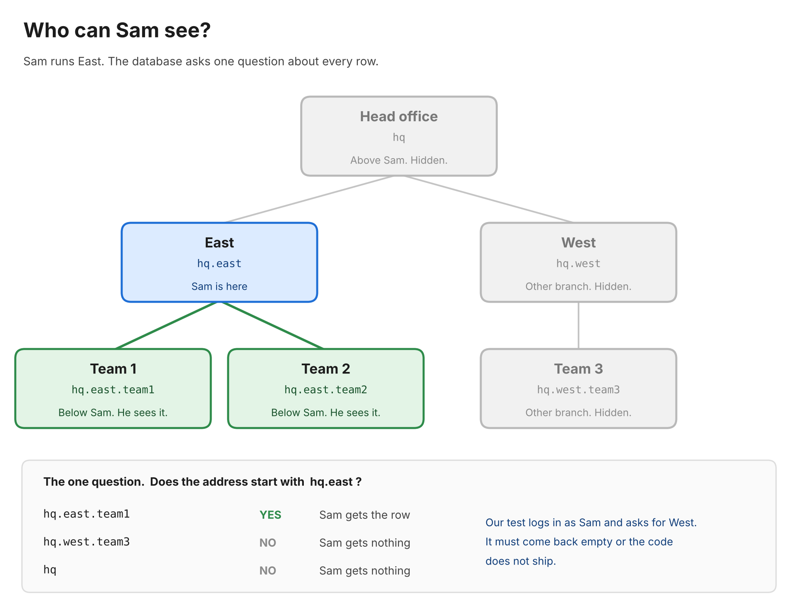

# Branch View

In this Supabase demo, a person sees only the people below them in their own branch of an organization tree, and the database enforces it, not the UI.



**Live demo:** https://molliteum-branch-view.vercel.app

```
PASS  1. Sam sees exactly Sam, Tia, Tom, Uma, Raj
PASS  2. Sam asks for Wes, Val and Zed by id and gets 0 rows
PASS  3. Sam asks for Hana by id and gets 0 rows
PASS  4. Sam sees only East, Team 1, Team 2 in organizations
PASS  5. Wes sees exactly Wes, Val, Zed
PASS  6. Hana sees all ten people
PASS  7. Tia sees only Tia, not Tom in the same team
PASS  8. Tia cannot see Uma or Raj in Team 2 (lateral)
PASS  9. Tia cannot see Sam or Hana (upward)
PASS  10. Sam cannot see Eli, who is also in East (strict mode)
PASS  11. A signed-out client sees 0 rows in every table and the view
PASS  12. A login with no people row sees 0 rows in every table and the view
PASS  13. Sam selects from vault_test and gets 0 rows
PASS  14. Sam cannot insert, update or delete a person
PASS  15. Sam cannot change their own org_id, and sees the same people after
PASS  16. Sam sees notes for Team 1 and Team 2 only
PASS  17. Sam cannot see Eastern, whose path starts with East's (prefix safety)
PASS  18. Moving Sam to West changes what Sam sees with no new login
PASS  19. Sam reads team_directory and gets the same five people
PASS  20. Sam cannot reach my_org_path in the private schema
PASS  21. Sam calls /rest/v1/rpc/my_org_path and it is not found
PASS  22. All four demo tables have RLS enabled and forced

22 of 22 passed
```

## The function and the policies

**`private.org_ids_below_me()`** returns the ids of every org strictly below the caller's own, using a path looked up live and never read from the JWT. It sits in a schema the API does not expose, and one commented line in it decides strict or inclusive.

**`people_select`** lets you see yourself and everyone in an org below you. Your own teammates are not below you, so they stay hidden.

**`organizations_select`** lets you see your own org and every org below it. It compares `path` directly with `<@`, so the GiST index serves it.

**`notes_select`** applies the same "below me" rule to different data. It exists to show the rule is reused, not rewritten.

## Run it

1. Create a Supabase project and turn off **Allow new users to sign up**.
2. Paste `supabase/migrations/0001_init.sql` into the SQL Editor and run it.
3. Copy `.env.example` to `.env.local` and fill in the values.
4. Run `npm install`, then `npm run seed`, then `npm test`.
5. Run `npm run dev` and open http://localhost:3000.
